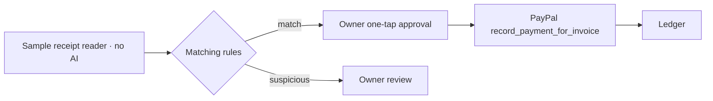

# OKI by AsisT
> Actualizado: 2026-11-08 16:18

<p align="center"></p>

> **Get paid the way Mexico pays.** Meet Coli, the hummingbird that brings back your receipts with a ✓.

OKI is a bilingual DEMO of accounts receivable for a Mexican small service business that can run without keys. People and transfer receipts are synthetic fixtures; the UI labels the demo and simulated chat `DEMO`. Templates include `DEMO`; Gemini is instructed to include it, but the draft gate does not validate that word. The code only permits the PayPal sandbox for its real adapter; it does not select live mode.

The default demo language is English. Set `OKI_LANG=es` for Spanish.

## AI configuration

Both the UI and CLI use the same selector: leave `GOOGLE_GENERATIVE_AI_API_KEY` unset to run the fixed-text template; with a key, Gemini drafts only the DEMO debtor message. `OKI_GEMINI_MODEL` optionally overrides the default in `src/ia/modelo.ts`. Each UI invoice stores its own draft origin and model: **live AI · Gemini + model**, **fixed template · no API key**, or **AI unavailable · template used**. Account and simulated chat show that origin in either language; no draft is labelled live before generation succeeds.

A draft must include the exact payment URL and at least one canonical amount (for example `1200.00 MXN` or `$1200.00 MXN`, case insensitive). Sentence punctuation after the exact URL is accepted. Other detected URLs (including uppercase schemes, `www.` and bare domains) are rejected. After removing exact URLs and canonical amounts, the gate rejects every remaining digit, currency symbol, ISO currency code supported by Node, and the currency names listed in `src/agente/cobrar.ts`. This conservative format check can also reject dates or other non-monetary digits; it does not interpret arbitrary prose about money. Failure, invalid payment details or a 20-second timeout per draft uses the fixed template and shows a bounded reason. The request is aborted on timeout; late output is ignored. Two sequential drafts may therefore take up to about 40 seconds. The Gemini key stays on the server; Gemini error bodies and raw error messages are not returned or logged by the draft handler. PayPal errors in the CLI are outside that bounded error handler. Never commit a key.

```bash
npm test
npm run demo
npm run demo:es
bash scripts/probar-demo.sh
```

The demo creates PayPal DEMO invoices, shows a readable account summary, reads two synthetic transfer receipts, approves the matching receipt, and leaves a repeated reference suspicious. It prints `LEDGER_*_JSON` only as a stable machine-readable ledger record; the account summaries are the human-facing output.

For a PayPal sandbox run, inject `PAYPAL_CLIENT_ID` and `PAYPAL_CLIENT_SECRET`, set `PAYPAL_ENVIRONMENT=SANDBOX`, then run either `npm run demo:sandbox` or `npm run demo:sandbox:es`. Do not store keys in this repository. After a partial payment, the demo reads the balance from PayPal's `due_amount` (or derives it from total minus `payments.paid_amount`). When `send_invoice` provides a `payer-view` link, the debtor message uses that link; QR data remains separate and is never inserted into the message.

## AI guardrails

The UI and simulated CLI read synthetic receipt fixtures with `LectorComprobanteSimulado`. The UI labels its reader **sample receipt · no AI**. `LectorComprobanteReal` exists separately but is not connected to either demo. Gemini only drafts collection messages: it cannot approve, change ledger balances or choose payment states. Deterministic rules decide matching and every suspicious reason: amount over balance, duplicate reference, date window, confidence, no candidate, or multiple candidates. In the UI, the owner approval action records an external payment, then queries PayPal for its balance; invoice creation and sending happen earlier. The CLI is a scripted demo: it automatically approves the matching fixture in simulated mode, and automatically records a test partial payment in sandbox mode, without an interactive owner action.



## Transfer methods

`config/transferencias.json` is the transfer configuration used by the demo. Add a method with a unique `id`, a display `nombre`, and a `campos` array that includes `referencia`. Supported fields are `referencia`, `claveRastreo`, and `bancoEmisor`. The included `spei` method uses all three and `generico` uses `referencia`. Invalid configuration stops with an error.

## Español

OKI es una DEMO bilingüe, sin llaves incluidas, para gestionar cuentas por cobrar. Para correrla en español usa `npm run demo:es`; con credenciales sandbox ya configuradas, usa `npm run demo:sandbox:es`. La demo muestra el resumen de cada cuenta en español y genera el mensaje de cobro. El chat de la UI es simulado. Las plantillas llevan DEMO; a Gemini se le pide incluirlo, pero el candado no valida esa palabra.

### Configuración de IA

La UI y el CLI usan el mismo selector. Sin `GOOGLE_GENERATIVE_AI_API_KEY`, usan plantilla fija. Con llave, Gemini redacta únicamente el mensaje DEMO de cobro. `OKI_GEMINI_MODEL` sustituye opcionalmente el modelo de `src/ia/modelo.ts`. Cada cobro de la UI conserva su origen y modelo: **IA en vivo · Gemini + modelo**, **plantilla fija · sin llave** o **IA no disponible · se usó plantilla**. Cuenta y chat simulado muestran ese resultado al cambiar de idioma; un borrador todavía sin generar no se anuncia como IA en vivo.

Se exige la liga exacta de pago y al menos un monto canónico (por ejemplo `1200.00 MXN` o `$1200.00 MXN`, sin distinguir mayúsculas). Se admite puntuación de frase después de la liga exacta. Se descartan otras ligas detectadas, incluidos esquemas en mayúsculas, `www.` y dominios sin esquema. Tras retirar las ligas exactas y los montos canónicos, se rechaza cualquier dígito, símbolo monetario, código ISO de moneda admitido por Node o nombre de moneda listado en `src/agente/cobrar.ts`. Es un control conservador de formato: también puede descartar fechas u otras cifras no monetarias; no interpreta cualquier frase sobre dinero. Ante fallo, datos de pago inválidos o un límite de 20 segundos por borrador, se usa plantilla y se muestra un motivo acotado. Se aborta la llamada al vencer el plazo y se ignoran las respuestas tardías. Dos borradores consecutivos pueden tardar unos 40 segundos. La llave de Gemini permanece en el servidor; el manejador del borrador no devuelve ni registra cuerpos ni mensajes de error crudos de Gemini. Los errores PayPal del CLI están fuera de ese manejador acotado. Nunca guardes una llave en el repositorio.

La UI y el CLI simulado leen comprobantes sintéticos con `LectorComprobanteSimulado`. La UI rotula su lector **comprobante de muestra · sin IA**. Existe un lector real separado, pero ninguna demo lo conecta. Gemini no aprueba, no cambia saldos ni elige estados de pago: el empate y los motivos sospechosos los determinan reglas. En la UI, la aprobación del dueño registra el pago externo y después consulta su saldo en PayPal; crear y enviar el cobro ocurre antes. El CLI es una demo programada: aprueba automáticamente la muestra coincidente en modo simulado y registra automáticamente un pago parcial de prueba en sandbox, sin acción interactiva del dueño.

## Run the UI

```bash
npm run ui
# Spanish / Español; optional port / puerto opcional:
OKI_LANG=es OKI_UI_PORT=4173 npm run ui
```

Open `http://127.0.0.1:4173`. **DEMO · PayPal simulated** without keys; **DEMO · PayPal sandbox** with both `PAYPAL_CLIENT_ID` and `PAYPAL_CLIENT_SECRET` injected. Only SANDBOX is accepted. Portfolio → collect overdue → send to simulated chat → client sends sample → approve → updated balance. Banxico: manual lookup with copyable CEP details. Desktop: both roles; mobile: tabs. Reset clears memory; PayPal keeps sandbox invoices. PayPal mode is independent of drafting: the message uses Gemini only when a Gemini key is configured and the validated draft succeeds; otherwise it uses a labelled template. The sample receipt reader uses no AI.

### Run the UI · Español

Abre la misma dirección. **DEMO · PayPal simulado** sin llaves; **DEMO · PayPal sandbox** con ambas variables. Cartera → cobrar vencidos → chat simulado → muestra → aprobar → saldo actualizado. Banxico: consulta manual. Reiniciar vacía memoria local. Previene el doble uso de un comprobante y errores de monto. Solo datos sintéticos, sin subidas. El modo PayPal es independiente del redactor: el mensaje usa Gemini solo con llave Gemini y borrador validado; en los demás casos usa plantilla con su rótulo. El comprobante de muestra sigue sin IA.

`BRAND_NAME`: `src/ui/state.ts`. Ambos modos usan `libroDemo`; solo se consultan cobros de sesión. Destino ilegible o distinto bloquea aprobación; si la cuenta es del negocio, declárala en `cuentasCobro`. Con `[]` no aplica esa regla. Sin CDN ni paquetes nuevos.

## Offline verification / Verificación sin red

`npm test` blocks external `fetch`, clears the Gemini key for tests and uses synthetic generators. It checks invoice-specific labels in ES/EN, exact link and amount, fallback, abort/late response, HTTP/HTML secrecy and owner approval. The browser script is exercised with an in-memory DOM facade, not a full browser. `npx tsc --noEmit` checks types. `bash tests/mutantes-ui.sh` temporarily changes production code for draft labels, the payment gate and key secrecy, including separate amount and URL mutations. It checks assertion failures and restores exact sources with an EXIT trap. It requires Bash, a compatible Node.js, installed project dependencies, Python 3, ripgrep (`rg`), `cp`, `cmp`, `mkdir`, `mktemp`, `dirname` and `env`. Originals, logs and temporary files are retained under `tests/.mutantes-ui/` inside the repository; run it with no concurrent edits to the mutated files.

`npm test` bloquea `fetch` externo, vacía la llave de Gemini y usa generadores sintéticos. Verifica rótulos ES/EN por cobro, liga y monto, respaldo, corte/respuesta tardía, ausencia de la llave en HTTP/HTML y aprobación del dueño. El script del navegador se ejecuta con una fachada DOM en memoria, sin navegador completo. `npx tsc --noEmit` comprueba tipos. `bash tests/mutantes-ui.sh` altera temporalmente código productivo de rótulos, candado de cobro y ausencia de llave, con mutaciones separadas de monto y liga. Comprueba fallos de aserción y restaura el original exacto con un trap EXIT. Requiere Bash, Node.js compatible, dependencias del proyecto instaladas, Python 3, ripgrep (`rg`), `cp`, `cmp`, `mkdir`, `mktemp`, `dirname` y `env`. Originales, registros y temporales se conservan en `tests/.mutantes-ui/`, dentro del repositorio; ejecútalo sin ediciones concurrentes a los archivos mutados.
