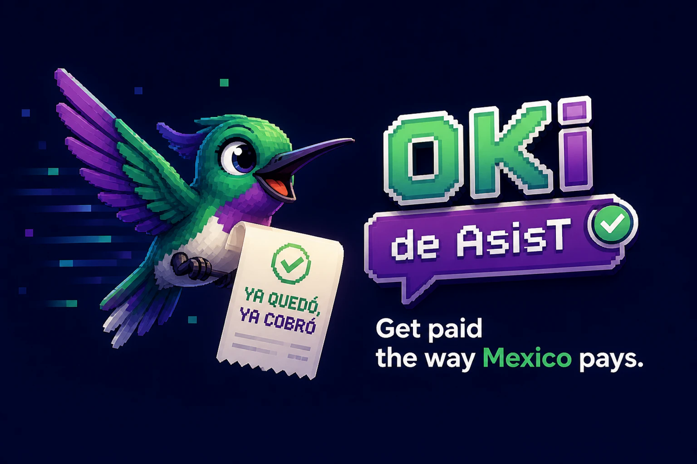
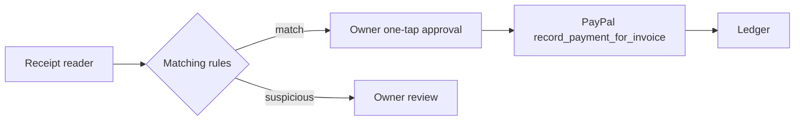

# OKI by AsisT

<p align="center"></p>

> **Get paid the way Mexico pays.** Meet Coli, the hummingbird that brings back your receipts with a ✓.

OKI is a keyless, bilingual DEMO of accounts receivable for a Mexican small service business. Every person, message, and transfer receipt is synthetic and labelled `DEMO`. The code only permits the PayPal sandbox for its real adapter; it does not select live mode.

The default demo language is English. Set `OKI_LANG=es` for Spanish.

## AI configuration

Leave `GOOGLE_GENERATIVE_AI_API_KEY` unset to run the fixed-text template. With a key, the demo uses Gemini to draft only the DEMO debtor message; money, matching, and approval remain deterministic. `OKI_GEMINI_MODEL` is optional and overrides the single default defined in `src/ia/modelo.ts`. If Gemini is unavailable, the demo reports the failure and uses the template. Never commit a key.

```bash
npm test
npm run demo
npm run demo:es
bash scripts/probar-demo.sh
```

The demo creates PayPal DEMO invoices, shows a readable account summary, reads two synthetic transfer receipts, approves the matching receipt, and leaves a repeated reference suspicious. It prints `LEDGER_*_JSON` only as a stable machine-readable ledger record; the account summaries are the human-facing output.

For a PayPal sandbox run, inject `PAYPAL_CLIENT_ID` and `PAYPAL_CLIENT_SECRET`, set `PAYPAL_ENVIRONMENT=SANDBOX`, then run either `npm run demo:sandbox` or `npm run demo:sandbox:es`. Do not store keys in this repository. After a partial payment, the demo reads the balance from PayPal's `due_amount` (or derives it from total minus `payments.paid_amount`). When `send_invoice` provides a `payer-view` link, the debtor message uses that link; QR data remains separate and is never inserted into the message.

## AI guardrails

AI can read a receipt into a structured amount, date, transfer method, reference, bank, and confidence value. Deterministic rules decide matching and every suspicious reason: amount over balance, duplicate reference, date window, confidence, no candidate, or multiple candidates. The owner approval action records the payment; nothing is sent to PayPal before that action. PayPal is the payment record queried after recording.



## Transfer methods

`config/transferencias.json` is the transfer configuration used by the demo. Add a method with a unique `id`, a display `nombre`, and a `campos` array that includes `referencia`. Supported fields are `referencia`, `claveRastreo`, and `bancoEmisor`. The included `spei` method uses all three and `generico` uses `referencia`. Invalid configuration stops with an error.

## Español

OKI es una DEMO bilingüe, sin llaves incluidas, para gestionar cuentas por cobrar. Para correrla en español usa `npm run demo:es`; con credenciales sandbox ya configuradas, usa `npm run demo:sandbox:es`. La demo muestra el resumen de cada cuenta en español y manda al deudor un mensaje DEMO en español.

### Configuración de IA

Sin `GOOGLE_GENERATIVE_AI_API_KEY`, la demo usa texto fijo. Con una llave, Gemini redacta únicamente el mensaje DEMO al deudor; los montos, el empate y la aprobación siguen siendo deterministas. `OKI_GEMINI_MODEL` es opcional y sustituye el único modelo predeterminado de `src/ia/modelo.ts`. Si Gemini no está disponible, la demo lo informa y usa la plantilla. Nunca guardes una llave en el repositorio.
